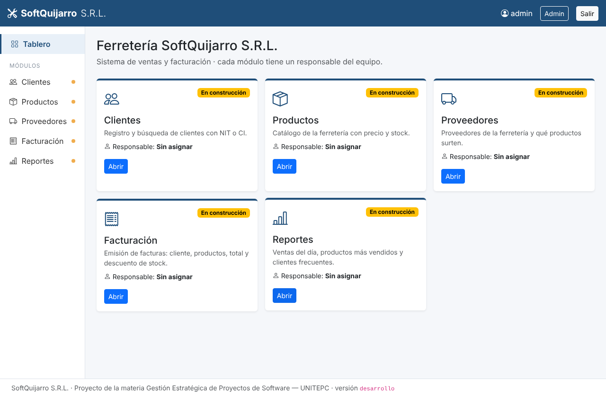

# SoftQuijarro S.R.L. — Sistema de ventas y facturación

Proyecto práctico de **Gestión Estratégica de Proyectos de Software** (UNITEPC, Ingeniería de
Sistemas). Cinco estudiantes construyen el sistema de una ferretería usando Scrum y GitHub,
cada uno dueño de un módulo.



**Sistema publicado:** _(el docente pega aquí la dirección de Render)_

## Equipo

| Módulo | Carpeta | Responsable | Usuario GitHub |
|---|---|---|---|
| Clientes | `clientes/` | | |
| Productos | `productos/` | | |
| Facturación | `facturacion/` | | |
| Proveedores | `proveedores/` | | |
| Reportes | `reportes/` | | |
| Product Owner | todo lo demás | Ing. Ariel Acuña Apaza | |

## Documentos

- 📘 [Guía del estudiante](docs/GUIA_ESTUDIANTE.md): cómo trabajar (empieza aquí)
- 📋 [Product backlog](docs/BACKLOG.md): las historias de cada módulo
- 🧭 [Guía del docente](docs/GUIA_DOCENTE.md): montaje, guion de las clases y evaluación

## Arranque rápido

**Code → Codespaces → Create codespace on main**, espera el mensaje "Listo" y escribe:

```bash
python manage.py runserver
```

Usuario **admin**, contraseña **admin123** (solo en tu Codespace).

## Tecnología

Django 5.2 · SQLite en desarrollo (cada estudiante tiene su propia base) · PostgreSQL en
producción · GitHub Codespaces · GitHub Actions (verificación automática de cada pull
request) · Render (despliegue automático de `main`).
